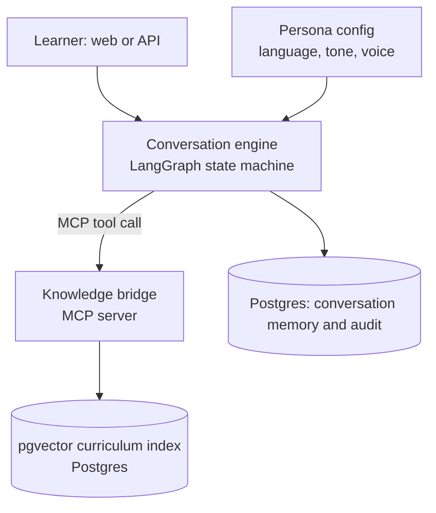

# Cumulus

[](https://github.com/Logan-Cope/cumulus/actions/workflows/ci.yml)

A cloud-architecture mentor bot that answers only from a real curriculum. It cites the
exact lesson behind every claim, and says "I don't have enough information from the
curriculum" instead of guessing.

Most "chat with your docs" demos hallucinate. Cumulus is built the other way round: the
substance comes from retrieved, cited material, the conversation is an explicit state
machine rather than a free-form chatbot, and a corrective loop re-checks weak retrievals
before the model answers. It is a reference implementation of a trustworthy RAG and agent
system, the same property any high-stakes advising assistant needs.

This is a reference build, not a hosted product: it needs your own Postgres with pgvector,
API keys and curriculum markdown, so there is no live demo.

## Architecture



See [`docs/ARCHITECTURE.md`](docs/ARCHITECTURE.md) for the principles and the reasoning
behind each choice.

**Core ideas**

- **Guided interview, deterministic spine.** LangGraph nodes are phases; the model supplies the language, the graph supplies the structure.
- **Grounded and cited only.** Retrieve, answer from context, cite the module and lesson, refuse when context is insufficient.
- **Hybrid retrieval.** Dense (pgvector) plus keyword (Postgres full-text), fused with Reciprocal Rank Fusion and an optional cross-encoder reranker, so exact terms like service names and commands are not missed.
- **Corrective RAG.** Grade retrieval, then re-query or refuse if it is weak (capped).
- **Persona is config, not code.** Add a mentor without touching the engine.
- **One database.** pgvector keeps app data, memory, audit and vectors in a single Postgres.

## Stack

| Layer | Choice |
|---|---|
| Orchestration | LangGraph |
| Models | Claude (Sonnet, Opus, Haiku, routed by task); OpenAI optional |
| Embeddings | Voyage or OpenAI `text-embedding-3-small` |
| Vector store | pgvector |
| Knowledge bridge | MCP server |
| API | FastAPI |
| Data store, memory, audit | PostgreSQL |

## Project layout

```
cumulus/
├── app/
│   ├── graph.py            LangGraph conversation engine (the spine)
│   ├── retrieval.py        hybrid search (the RAG core)
│   ├── rerank.py           optional reranker
│   ├── answer.py           grounded, cited answers
│   ├── mcp_server.py       MCP tools the agent calls (the knowledge bridge)
│   ├── personas/           persona configs (the swappable skin)
│   ├── api.py              FastAPI front door
│   └── config.py
├── ingest/                 offline: markdown, chunk, embed, pgvector
├── db/schema.sql           pgvector tables
├── data/curriculum/        raw curriculum markdown (gitignored, private)
├── docs/ARCHITECTURE.md
└── tests/                  unit tests plus a retrieval eval set
```

## Getting started

```bash
# 1. Install (uv recommended)
uv sync

# 2. Configure
cp .env.example .env   # add API keys and DATABASE_URL

# 3. Create the schema (Postgres with pgvector required)
psql "$DATABASE_URL" -f db/schema.sql

# 4. Ingest curriculum (after dropping markdown into data/curriculum/)
python -m ingest.chunk && python -m ingest.embed

# 5. Run
uvicorn app.api:app --reload
```

## Tests

```bash
uv run pytest -m "not eval"   # fast offline unit tests, run in CI
uv run python -m tests.eval   # retrieval eval: hit-rate@k, MRR, citation precision, refusals
```

The eval makes API and database calls, so it runs locally against your own index rather
than in CI.

## MCP server (knowledge bridge)

Retrieval is exposed as an [MCP](https://modelcontextprotocol.io) tool so the knowledge
layer is reusable and front-end agnostic. Any MCP client (the Cumulus graph, Claude
Desktop, another agent) can query the curriculum the same way.

```bash
uv run python -m app.mcp_server   # stdio transport, the MCP default
```

It exposes one tool:

- **`search_curriculum(query: str, module: str | None = None)`** searches the curriculum and returns the most relevant chunks, each with its `module`, `lesson`, `source_url` and similarity `score`, so every answer can cite the exact lesson. Pass `module` to restrict the search to one module.

The LangGraph engine retrieves through this tool, with a direct-retrieval fallback so a
transport hiccup never breaks the answer loop.

## License

[MIT](LICENSE) © 2026 Logan Cope
